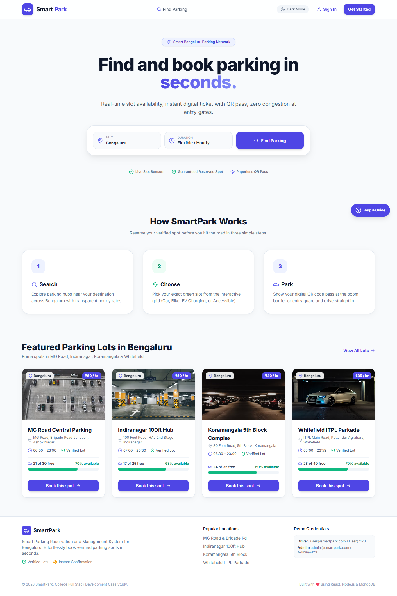
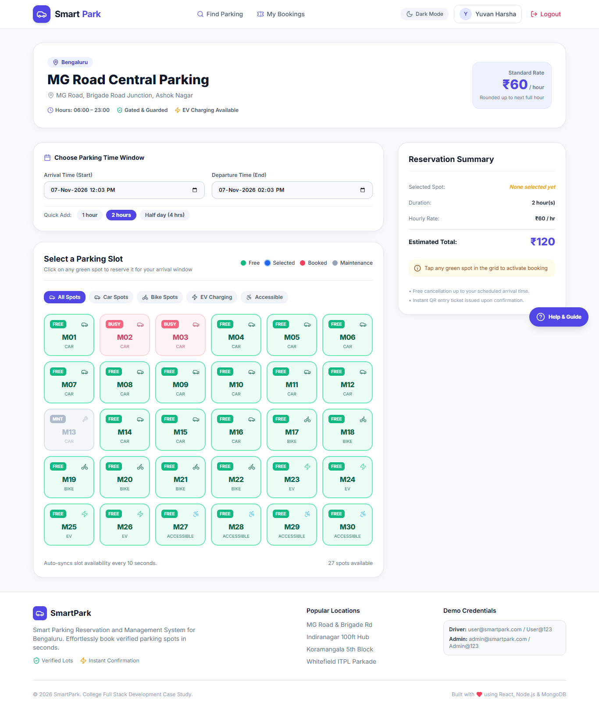
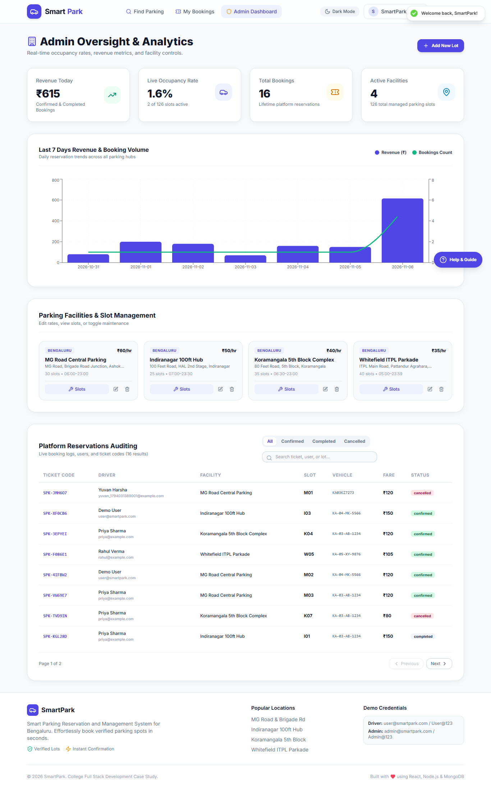

# SmartPark — Smart Parking Reservation & Management System

> **Live Production App**: [https://smartpark-client.vercel.app](https://smartpark-client.vercel.app)  
> **Live API Base URL**: [https://smartpark-server.vercel.app/api](https://smartpark-server.vercel.app/api)  
> **Database**: MongoDB Atlas M0 Cluster (`AP_SOUTH_1` Mumbai)

### 🚀 Instant Demo Credentials (1-Click in UI)
| Role | Email | Password | Quick Action |
| :--- | :--- | :--- | :--- |
| **Driver / User** | `user@smartpark.com` | `User@123` | Click **"Try as Driver"** on `/login` |
| **System Admin** | `admin@smartpark.com` | `Admin@123` | Click **"Try as Admin"** on `/login` |

---

SmartPark is an end-to-end full stack smart parking solution designed to streamline urban parking slot discovery, real-time availability tracking, digital reservation management, and admin oversight.

---

## Verified Prototype Screenshots

| Landing Page | Interactive Slot Picker (10s Live Sync) |
| :---: | :---: |
|  |  |

| Administrative Analytics & Facility Controls |
| :---: |
|  |

---

## Key Features

- **Driver Portal**:
  - Location search across Bengaluru parking hubs (MG Road, Indiranagar, Koramangala, Whitefield) with List and Leaflet Map views.
  - Interactive clickable Slot Picker grid with color-coded status (Green = Free, Blue = Selected, Red = Booked, Gray = Maintenance).
  - 10-second auto-syncing slot availability with past-time blocking and instant duration chips.
  - Multi-step checkout with Indian vehicle registration validation and clearly labelled demo payments.
  - Digital QR entry passes with print and JSON download support.
  - Reservation history with Upcoming, Past, and Cancelled tabs.
- **Admin Oversight**:
  - Live analytics cards for today's revenue, real-time occupancy rate, and total bookings.
  - Recharts 7-day revenue and booking volume historical charts.
  - Platform audit table with multi-field search, status filtering, and pagination.
  - Full CRUD on parking facilities with slot maintenance toggles.
  - Role-gated access with friendly non-admin fallback screen.
- **Production Hardened & Serverless Ready**:
  - Zero-setup local development with automatic in-memory MongoDB fallback and auto-seeding.
  - Cached Mongoose connections across serverless invocations for Vercel.
  - Dynamic derivation of expired bookings replacing background cron for 100% serverless compatibility.
  - Rate limiting, Helmet, Mongo sanitization, bcrypt password hashing, and JWT authorization.

---

## Technology Stack

- **Frontend**: React 18 (Vite), React Router v6, Tailwind CSS, Lucide React, Recharts, React-Leaflet, React-Hot-Toast, QRCode.react.
- **Backend**: Node.js, Express.js, Mongoose ODM, JWT, BcryptJS, Express-Validator, Helmet, CORS, Rate-Limit.
- **Database**: MongoDB Atlas (Production) / In-Memory MongoDB (Local Zero-Setup).
- **Deployment**: Vercel Serverless Functions + Vercel Static Edge Network.

---

## 5-Step Local Setup Guide

### 1. Prerequisites
- Node.js v18+ and npm v9+ installed.

### 2. Clone and Install Dependencies
```bash
git clone https://github.com/yuvanharshaj/FSD-PROJECT.git
cd FSD-PROJECT
npm run install:all
```

### 3. Environment Setup (Optional for Local Zero-Setup)
```bash
cp server/.env.example server/.env
```
*(Leave `MONGO_URI` blank to automatically run an in-memory MongoDB pre-seeded with Bengaluru facilities!)*

### 4. Run Both Server & Client Concurrently
```bash
npm run dev
```
- Frontend: `http://localhost:5173`
- Backend API: `http://localhost:5000`

### 5. Run Automated Tests
```bash
# Backend smoke test suite (10/10 checks)
npm run test:smoke

# Single-pass browser E2E test suite (6/6 checks)
npm run test:e2e
```

---

## Instant Demo Credentials (1-Click in UI)

- **Driver Account:** `user@smartpark.com` / `User@123` *(or click "Try as Driver" on login)*
- **Admin Account:** `admin@smartpark.com` / `Admin@123` *(or click "Try as Admin" on login)*

---

## Repository Structure

```
FSD-PROJECT/
├── client/              # React (Vite) Single Page Application
│   ├── src/
│   │   ├── components/  # Navbar, LotCard, SlotGrid, BookingCard, StatCard, Modals
│   │   ├── context/     # AuthContext (JWT + Demo profiles) & ThemeContext (Dark/Light)
│   │   ├── pages/       # Landing, FindParking, LotDetails, BookingConfirm, Admin
│   │   ├── services/    # Axios client with VITE_API_URL and bearer interceptor
│   │   ├── App.jsx      # React Router configuration & global layout
│   │   └── main.jsx     # DOM entry point
│   ├── vercel.json      # Client SPA rewrites
│   └── package.json
├── server/              # Backend Express API & Serverless Handlers
│   ├── api/
│   │   └── index.js     # Vercel serverless function entry point
│   ├── src/
│   │   ├── config/      # Cached Mongoose connection (Atlas / Memory fallback)
│   │   ├── controllers/ # Auth, Lot, Booking, and Admin controllers
│   │   ├── middleware/  # JWT auth, role authorization, central error handler
│   │   ├── models/      # Mongoose schemas: User, ParkingLot, Slot, Booking
│   │   ├── routes/      # Express API routes
│   │   ├── app.js       # Express configuration (Helmet, CORS, Rate Limit)
│   │   ├── index.js     # Standalone local HTTP listener
│   │   └── seed.js      # Database seeder (4 Bengaluru lots, 130 slots, bookings)
│   ├── scripts/         # backup.js and restore.js collection utilities
│   ├── test/            # Backend smoke tests
│   ├── vercel.json      # Vercel serverless route mappings
│   └── package.json
├── docs/
│   ├── api-docs.md      # REST API endpoints and sample JSON payloads
│   └── screenshots/     # Verified UI screenshots
├── DEPLOY.md            # 7-step production deployment guide for Vercel + Atlas
├── test-e2e.js          # Automated headless browser verification suite
├── package.json         # Root scripts (dev, build, backup, restore, tests)
└── .gitignore           # Git ignore rules
```

---

## Production Deployment

Detailed step-by-step instructions for deploying to Vercel and MongoDB Atlas are documented in [`DEPLOY.md`](./DEPLOY.md).
