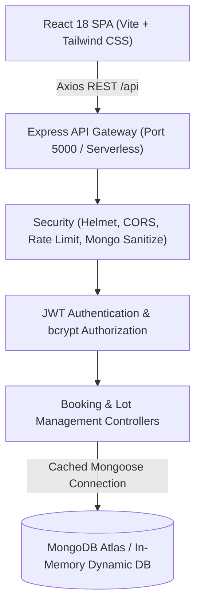
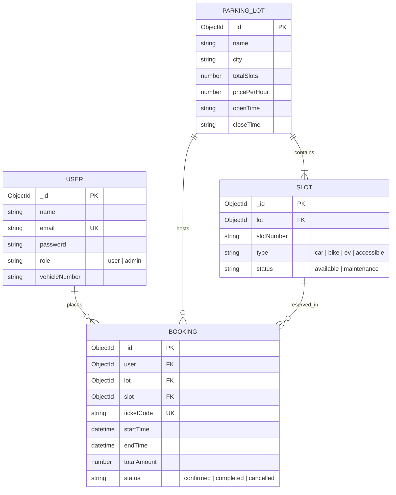

# SmartPark: Smart Parking Reservation & Management System
## Academic Presentation & Defense Slide Deck (5th-Semester Full Stack Development Case Study)

---

### Slide 1: Title & Introduction
- **Project Title**: **SmartPark** — Smart Parking Reservation and Management System
- **Subject**: Full Stack Web Development (5th Semester Case Study)
- **Tech Stack**: React 18, Vite, Tailwind CSS, Node.js, Express.js, MongoDB (Mongoose), JWT, Docker
- **Repository**: [https://github.com/yuvanharshaj/FSD-PROJECT](https://github.com/yuvanharshaj/FSD-PROJECT)

---

### Slide 2: Problem Statement & Motivation
- **The Urban Dilemma**: In dense metropolitan areas (e.g., Bengaluru), drivers spend an average of 15–20 minutes searching for available parking, exacerbating traffic bottlenecks and fuel consumption.
- **Pain Points of Legacy Systems**:
  - Lack of real-time availability visibility prior to arrival.
  - Risk of double-booking under peak holiday/office rush hours.
  - Paper receipts that are easily lost or tampered with.
  - No unified dashboard for lot managers to monitor occupancy rates and revenue.
- **SmartPark Solution**: A real-time, responsive web application enabling drivers to discover, reserve, pay for, and receive QR-coded parking passes within 60 seconds.

---

### Slide 3: System Objectives & Deliverables
1. **Zero-Friction Driver Experience**: 1-click demo logins, dynamic slot picker with 10-second auto-refresh, and Indian vehicle validation (`KA01AB1234`).
2. **Deterministic Concurrency Control**: Strict time-overlap validation preventing double bookings on identical slots.
3. **Admin Transparency**: Live analytics with Recharts tracking occupancy rates, 7-day revenue, and slot maintenance controls.
4. **Zero-Setup Local Evaluation**: Automatic fallback to `mongodb-memory-server` and instant database seeding on launch.
5. **Production & Serverless Readiness**: Decoupled Express backend exportable as Vercel serverless functions with connection caching.

---

### Slide 4: System Architecture

---

### Slide 5: Database Design & Entity Relationship
- **Four Core Schemas**: `User`, `ParkingLot`, `Slot`, and `Booking`.
- **Relationship Highlights**:
  - Each `ParkingLot` has $N$ child `Slot` entities referencing its `_id`.
  - Each `Booking` links a `User`, a `ParkingLot`, and a target `Slot`.
  - Overlap is queried dynamically across `[startTime, endTime]` without locking table writes.

---

### Slide 6: Key Innovations & Features
- **Interactive Visual Slot Picker**: Color-coded grid (Green: Available, Red: Booked for window, Blue: Selected, Gray: Maintenance) with 10s auto-synchronization.
- **Dynamic Serverless Status Derivation**: Eliminated cron daemon dependencies; booking expiration (`completed`) is derived deterministically at serialization time (`toJSON`) when `Date.now() > endTime`.
- **Digital QR Ticket Passes**: Printable passes embedded with unique `SPK-XXXX` codes and JSON ticket receipt export for barrier gate verification.
- **Inclusive Design**: Full dark/light theme switching, responsive down to 375px mobile viewports, and floating 4-step quick guidance.

---

### Slide 7: Security & Concurrency Defense
| Layer | Threat Mitigated | Technical Implementation |
| :--- | :--- | :--- |
| **Authentication** | Password Exposure & Session Hijacking | bcryptjs 10-salt hashing, signed JWTs with expiration, passwords stripped via `toJSON` |
| **Concurrency** | Race condition double-booking | Time window overlap query `(startTime < newEnd && endTime > newStart)` checking confirmed bookings |
| **Data Injection** | NoSQL Operator Injection (`$gt`, `$ne`) | `express-mongo-sanitize` stripping malicious payload keys |
| **DDoS / Abuse** | Endpoint flooding & Brute-force | Tiered `express-rate-limit` (15 req/15 min on `/auth`, 300 req/15 min on `/api`) |
| **Connection Pooling** | Atlas exhaustion in Serverless | Cached connection promise `global.mongoose = { conn, promise }` |

---

### Slide 8: Demonstration & Visual Workflows
1. **Landing & Discovery**: City search bar, featured lots, and real-time free/total capacity indicators.
2. **Slot Selection**: Quick reservation chips (1 Hour, 2 Hours, Half Day) with dynamic price calculation.
3. **Checkout**: Indian vehicle regex validation (`^[A-Z]{2}[0-9]{1,2}[A-Z]{1,2}[0-9]{4}$`) and simulated payment pathways.
4. **Administration**: KPI cards, 7-day revenue trend line chart, and real-time maintenance overrides.

*(Screenshots preserved in `docs/screenshots/landing.png`, `slot-picker.png`, and `admin-dashboard.png`)*

---

### Slide 9: Automated Verification & Testing
- **10/10 Smoke Test Pass (`server/test/smoke-test.js`)**:
  - Validates authentication, password protection, slot filtering, pricing formulas, overlap rejection (409 Conflict), and admin route protection (403 Forbidden).
- **11/11 End-to-End Headless Browser Pass (`test-e2e.js`)**:
  - Exercises full user journey from registration through slot reservation, QR ticket render, and admin dashboard operations.
- **CI/CD Automation (`.github/workflows/ci.yml`)**:
  - Automated GitHub Actions workflow executing smoke tests, build validation, and backup/restore tests on Node 20.x.

---

### Slide 10: Viva Voce — High-Frequency Examination Questions

#### Q1: Why did you eliminate `node-cron` for status transitions?
> **Answer**: `node-cron` requires a persistently active Node process. On serverless hosting platforms like Vercel, serverless instances freeze between incoming HTTP requests, which halts cron triggers. SmartPark solves this by calculating booking completion on read/serialization (`toJSON`) when current time exceeds `endTime`, delivering 100% serverless compliance.

#### Q2: How does the application prevent two users from booking the same slot at the same time?
> **Answer**: When a booking request is received, the backend executes an atomic database lookup for active reservations on that specific slot where `startTime < requestedEndTime && endTime > requestedStartTime`. If a match is found, HTTP `409 Conflict` is returned immediately.

#### Q3: How does the app operate on computers without MongoDB installed?
> **Answer**: Through an intelligent fallback mechanism in `db.js`. If `MONGO_URI` is not provided and the environment is not production, the server automatically starts an embedded `mongodb-memory-server` binary and seeds initial Bengaluru lots and users on launch.

---

### Slide 11: Deployment & DevOps Architecture
- **Dual Vercel Deployment**:
  - **Backend**: Serverless Node.js functions routed via `/server/vercel.json`.
  - **Frontend**: High-speed edge CDN routing with SPA client rewrites via `/client/vercel.json`.
- **Database**: Cloud-hosted MongoDB Atlas with `0.0.0.0/0` IP allow-listing.
- **Containerization**: Ready-to-deploy multi-container setup via `Dockerfile` and `docker-compose.yml`.

---

### Slide 12: Future Roadmap & Conclusion
- **Hardware Integration**: Microcontroller barrier gate trigger via MQTT / WebSockets using ESP32.
- **Automated License Plate Recognition (ANPR)**: Camera-based automated check-in and check-out.
- **Dynamic Pricing & EV Charging**: Peak-hour pricing algorithms and kilowatt-hour tracking for EV slots.
- **Conclusion**: SmartPark demonstrates an enterprise-grade, production-hardened Full Stack application that solves real urban logistics problems with zero setup friction and modern engineering standards.

