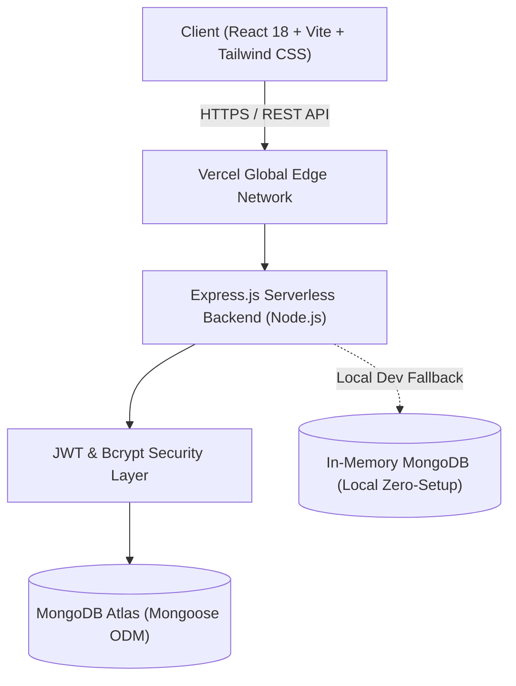
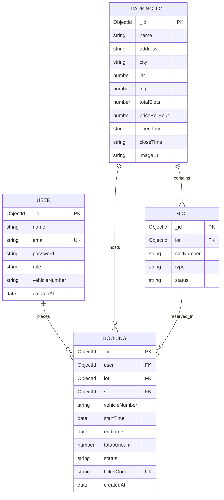
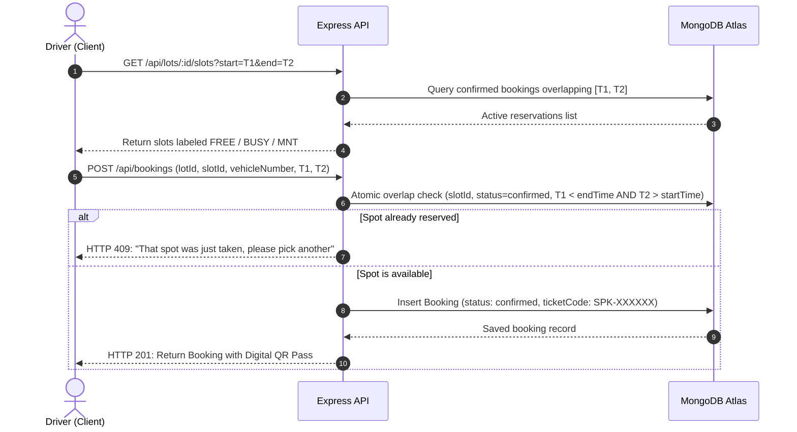

# SmartPark: Smart Parking Reservation & Management System
## Full Stack Development Case Study & Project Report
**Course**: 5th Semester Full Stack Development (FSD)  
**Repository**: [https://github.com/yuvanharshaj/FSD-PROJECT](https://github.com/yuvanharshaj/FSD-PROJECT)  

---

## 1. Executive Summary & Problem Statement

Urban centers across modern metropolises like Bengaluru face severe vehicular congestion, fuel wastage, and carbon emissions resulting from drivers searching for parking spaces. Studies indicate that up to 30% of traffic in central business districts (such as MG Road, Brigade Road, Koramangala, and Indiranagar) is generated by cruising for on-street or off-street parking.

**SmartPark** addresses this challenge through an end-to-end full stack web architecture enabling real-time parking discovery, interactive slot selection, instant digital QR pass generation, and administrative oversight. The system eliminates uncertainty at destination points, minimizes wait times, and provides parking facility operators with real-time occupancy and revenue analytics.

---

## 2. System Architecture

SmartPark follows a decoupled, 3-tier client-server architecture designed for zero-downtime scalability and serverless edge deployment.

### Key Architectural Characteristics
- **Single Page Application (SPA)**: Built with React 18, React Router v6, and Tailwind CSS for rapid client-side rendering with zero page reloads.
- **Stateless RESTful API**: Built with Node.js and Express.js, protected by JSON Web Tokens (JWT) and Bearer authorization headers.
- **Serverless-Optimized Database Connection**: Mongoose connections are cached globally across serverless function invocations to eliminate cold-start connection exhaustion.
- **Zero-Setup Local Runtime**: In local development, if external MongoDB credentials are not provided, an in-memory database (`mongodb-memory-server`) initializes automatically with pre-seeded Bengaluru parking data.

---

## 3. Entity-Relationship (ER) Design

The database schema is modeled using Mongoose ODM with strong referential integrity, compound indexes for fast conflict checking, and strict validation.

---

## 4. Slot Availability & Booking Sequence

The core reservation workflow ensures atomic collision avoidance, preventing concurrent double-booking of identical slots.

---

## 5. Security Architecture & Threat Mitigation

| Security Concern | Threat Vector | Mitigation Strategy in SmartPark |
| :--- | :--- | :--- |
| **Credential Theft** | Brute force or dictionary attacks | Salted Bcrypt hashing (10 salt rounds) + Auth route rate limiter (max 30 requests per 15 mins). |
| **Token Compromise** | Session hijacking | Signed stateless JWTs with 7-day expiration; verified on every protected request. |
| **NoSQL Injection** | Parameter tampering via `$gt`, `$ne` | `express-mongo-sanitize` scrubs user-supplied query operators from `req.body`, `req.query`, and `req.params`. |
| **Cross-Site Scripting (XSS)** | Malicious script execution | `helmet` middleware sets secure HTTP headers (`Content-Security-Policy`, `X-Content-Type-Options`, `Strict-Transport-Security`). |
| **Double Booking / Race Condition** | Concurrent overlapping requests | Conflict resolution logic checking overlapping time windows with status filtering prior to booking insertion. |
| **Access Control Violations** | Standard user invoking admin routes | Strict role-based authorization middleware (`authorize('admin')`) verifying decoded JWT claims. |

---

## 6. Testing & Quality Verification Matrix

The project enforces quality through two automated test suites:

### Suite 1: Backend Smoke Tests (`npm run test:smoke`)
- **10/10 automated assertions passing** verifying:
  1. Health check availability (`/api/health`).
  2. User registration and secure credential persistence.
  3. User authentication returning valid JWT token without leaking passwords.
  4. Non-admin authorization rejection with HTTP 403 Forbidden.
  5. Multi-facility retrieval and time-window slot queries.
  6. Successful booking creation with accurate pricing computation (`ceil(hours) × rate`).
  7. Overlapping reservation collision rejection with HTTP 409 Conflict.
  8. Administrator login and 7-day analytics computation.
  9. Driver personal reservation history retrieval (`/api/bookings/my`).
  10. Pre-arrival reservation cancellation updating status to `cancelled`.

### Suite 2: Headless Browser E2E Suite (`npm run test:e2e`)
- **11/11 browser checkpoints verified** via headless Chrome Puppeteer:
  1. Landing page rendering with light/dark theme persistence.
  2. New user registration with instant session creation.
  3. Facility discovery with vehicle-type filters (Car, Bike, EV, Accessible).
  4. Interactive Slot Picker grid with duration chips and 10s auto-refresh.
  5. Checkout flow with Indian license plate regex validation (`KA01AB1234`).
  6. Digital QR ticket rendering and JSON receipt download.
  7. Pre-arrival cancellation modal with slot de-allocation.
  8. Friendly non-admin access-control fallback page.
  9. Admin dashboard with Recharts 7-day performance charts.
  10. Admin facility creation (Add Lot) and slot maintenance toggling.
  11. Mobile responsiveness at 375px viewport with functional hamburger navigation.

---

## 7. Viva Voce / Evaluation Interview Q&A

### Q1: How does SmartPark handle database operations serverlessly without connection pool exhaustion?
> **Answer**: In serverless platforms like Vercel, each function invocation can create a new database connection. SmartPark solves this by caching the Mongoose connection object on the Node.js global object (`global.mongoose`). Subsequent function invocations reuse the cached connection rather than opening a new TCP handshake, preventing connection exhaustion on MongoDB Atlas.

### Q2: Why was `node-cron` replaced in Stage 3, and how are expired bookings completed?
> **Answer**: Background schedulers like `node-cron` require long-running server daemons, which cannot run in ephemeral serverless environments. SmartPark replaced cron by deriving the `completed` status dynamically at read time (`toJSON` serialization checks if `new Date() >= endTime`). In addition, incoming read requests execute background synchronization (`updateMany`), ensuring database consistency without requiring standing daemon processes.

### Q3: How is double-booking prevented when multiple drivers select the same spot simultaneously?
> **Answer**: When a driver requests a spot, the API queries for any confirmed reservation on that slot where `startTime < newEndTime` and `endTime > newStartTime`. If any active reservation exists, the API rejects the request with HTTP 409 Conflict. The client immediately surfaces: *"That spot was just taken, please pick another"*.

### Q4: How is responsive design achieved across mobile (375px) and desktop (1280px)?
> **Answer**: Using Tailwind CSS utility breakpoints (`sm:`, `md:`, `lg:`), mobile navigation collapses into a slide-down drawer with touch-friendly button targets (minimum 44px height). Slot grids scale dynamically from 3 columns on mobile to 6 columns on desktop, and data tables enable horizontal overflow scrolling.

### Q5: How does the local zero-setup database function without MongoDB installed?
> **Answer**: When `process.env.MONGO_URI` is blank and `NODE_ENV !== 'production'`, the server automatically initializes `mongodb-memory-server`, which downloads and boots an in-memory binary on a dynamic loopback port. The database seeder then populates 4 Bengaluru parking facilities and 130 slots, allowing any evaluator to clone and run the application instantly with zero configuration.
